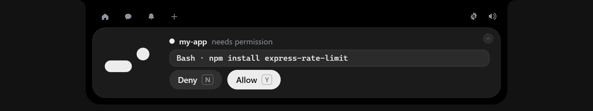
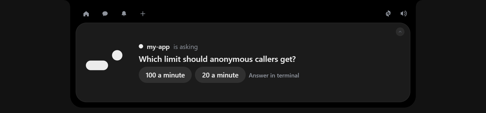
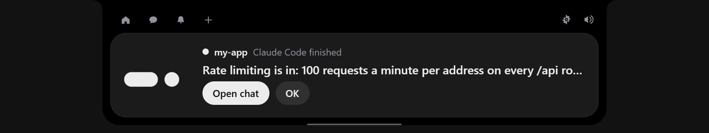
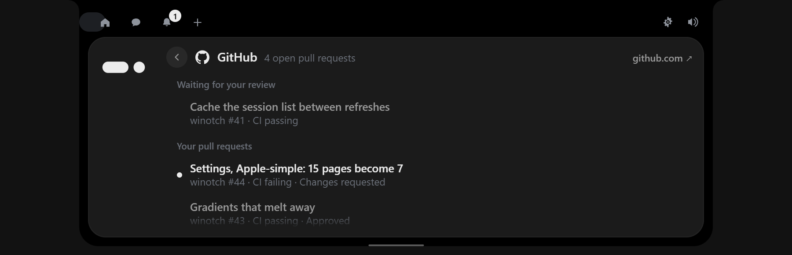
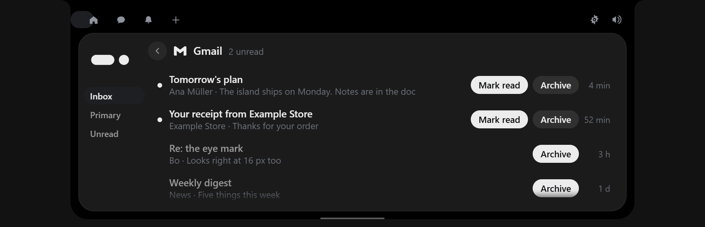
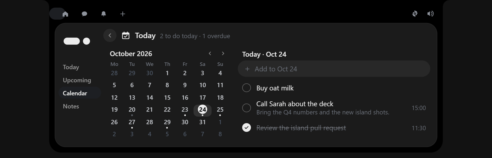
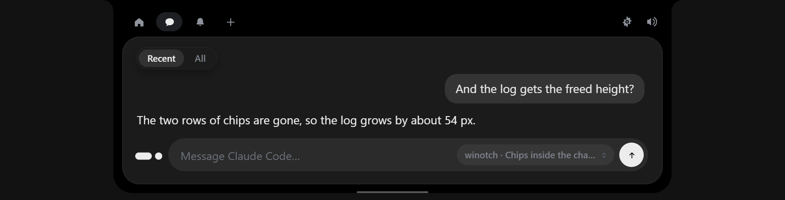
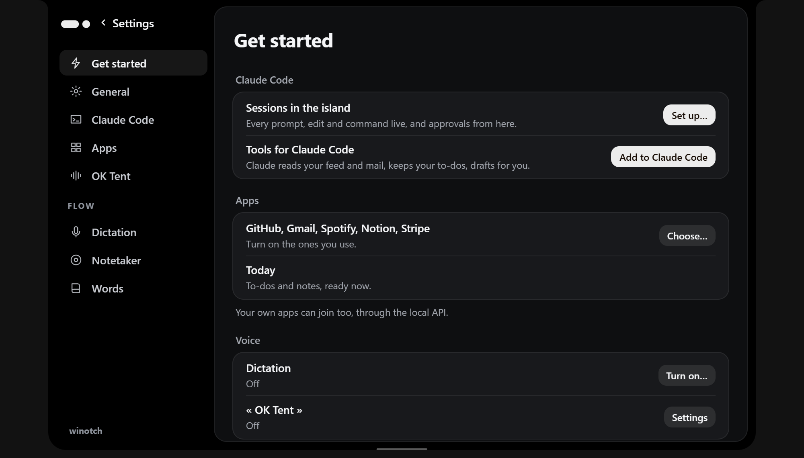
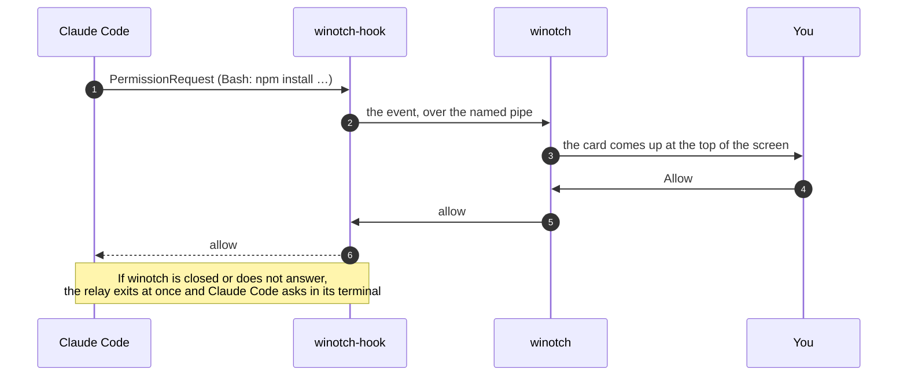

<div align="center">

# winotch

**A Dynamic Island for Windows, built on Claude Code.**

Every Claude Code session, live at the top of your screen. Approve, answer and chat without switching windows, and keep your mail, GitHub, to-dos and your own apps in one place that Claude Code can read too.

[](https://github.com/ArynBuilds/winotch/actions/workflows/ci.yml)
[](LICENSE)


[Download](#install) · [Running](docs/running.md) · [Local API](docs/api.md) · [Architecture](docs/architecture.md) · [Security](SECURITY.md) · [Contributing](CONTRIBUTING.md)

</div>

---

<p align="center"></p>

winotch is a small island that lives at the top centre of your screen. It stays a thin line until something needs you, then opens just enough to show it.

- **Every Claude Code session, live.** Each prompt, file read or edit, command and question from any terminal, through Claude Code's own hooks. Click a file to see its diff.
- **Approve and answer from the island.** Permission requests and Claude's questions come up as a card with their buttons, wherever you are working. Nothing is approved without your click.
- **Quiet while Claude works.** The island opens only when a session finishes, fails or needs you.
- **Chat with your sessions.** Continue any Claude Code session from the island, or type straight into one that is open in a terminal.
- **One feed for your apps.** GitHub, Gmail, Spotify, Notion, Stripe and Today (to-dos, a calendar, notes and reminders) are built in. Any program can join through a [local API](docs/api.md).
- **Claude Code can use it.** With one click, Claude Code gets winotch's tools: it can read your feed, search your mail and save drafts, keep your to-dos and open your sessions. It drafts, and you press the buttons.
- **Voice, on your computer.** Hold a key to dictate anywhere, record a call's notes, or say « OK Tent ». Speech is recognised locally.
- **Light.** Nothing draws, polls or wakes while nothing changes. Idle, it uses about 0 % CPU.

<table>
  <tr>
    <td></td>
    <td></td>
  </tr>
  <tr>
    <td></td>
    <td></td>
  </tr>
  <tr>
    <td></td>
    <td></td>
  </tr>
</table>

## Install

Requirements: Windows 10 (1809 or newer) or Windows 11, and [Claude Code](https://docs.claude.com/en/docs/claude-code) for the sessions, the chat and the tools.

1. Download [**winotch-setup.exe**](https://github.com/ArynBuilds/winotch/releases/latest/download/winotch-setup.exe) and run it. It installs for your user only, with no admin prompt. A [Windows Installer package](https://github.com/ArynBuilds/winotch/releases/latest/download/winotch.msi) is there too.
2. The installer is not code-signed yet, so Windows shows **Windows protected your PC** the first time. Click **More info**, then **Run anyway**.
3. winotch starts at the top of your screen and opens **Get started**.

<p align="center"></p>

## Quick start

In **Get started**:

1. **Sessions in the island → Set up…** shows the exact change to `~/.claude/settings.json`, backs the file up and writes it only when you click. Then open a new Claude Code session: it shows in the island.
2. **Tools for Claude Code → Add to Claude Code** runs Claude Code's own `claude mcp add`. In any session, try *"What came in from GitHub today?"* or *"Remind me to call the bank tomorrow at 3pm"*.
3. **Apps → Choose…** turns on GitHub (signs in through the GitHub CLI), Gmail (an app password), Spotify, Notion or Stripe.

Move the pointer to the top centre of the screen to open the island; `Ctrl+Alt+Space` opens the chat from anywhere. The [running guide](docs/running.md) covers every app, voice, shortcuts, where your data lives, updating, uninstalling and troubleshooting.

## How it works

Claude Code runs `winotch-hook` on each hook event. The relay passes the event to the island over a named pipe tied to your Windows account, after checking that the island on the other end is your own, and for a permission request it waits for your answer:



The same relay, run as `winotch-hook mcp`, is the MCP server that gives Claude Code winotch's tools. It calls the [local API](docs/api.md), which any of your own programs can use to put themselves on the island:

```js
await fetch(`${url}/v1/notify`, {
  method: "POST",
  headers: { Authorization: `Bearer ${token}`, "Content-Type": "application/json" },
  body: JSON.stringify({ app: "deploys", title: "Production is live", actions: [{ id: "open", label: "Open" }] }),
});
```

[`examples/hello-app.mjs`](examples/hello-app.mjs) is a complete app in one file. The [architecture guide](docs/architecture.md) describes the pieces and how they fit.

## Privacy and security

- Everything stays on your computer. winotch talks only to the services you connect (GitHub, Gmail, Notion, Stripe, and the Claude API if you add a key). There is no telemetry.
- Keys, tokens and app passwords are kept in Windows Credential Manager, never in a file.
- Claude Code's configuration is only changed when you click, after you have seen the change. Nothing is approved, sent or posted without your click, and Claude Code's tools cannot press a button for you.
- The local API listens on `127.0.0.1` only and needs a token that changes at every start.

[SECURITY.md](SECURITY.md) has the full security model and how to report a vulnerability.

## Status

winotch is young software, used every day by its author.

- Windows 10 and 11. The code builds on Linux, but Linux is untested and has no release.
- The installers are not code-signed yet.
- The Stripe app is the least tested.
- The interface is in ten languages; the newest screens are complete in all of them, and a few older strings may still show in English.

## Development

```sh
git clone https://github.com/ArynBuilds/winotch.git && cd winotch
npm install
npm run tauri dev      # the app, with the front end reloading live
npm test               # island and MCP tests (build the relay first: cargo build --release -p winotch-hook)
cargo test --workspace # Rust tests
```

You need Node.js 22.18 or newer, Rust (stable), and the [Tauri prerequisites for Windows](https://v2.tauri.app/start/prerequisites/). Most views can be worked on in a plain browser with `npx vite` and the preview pages in `dev/`. [CONTRIBUTING.md](CONTRIBUTING.md) covers the setup, the rules and the pull-request checklist. Please follow the [Code of Conduct](CODE_OF_CONDUCT.md).

## Credits

winotch began as a fork of [Coucou](https://github.com/Louis-CFM/coucou) by Louis Raillé, whose Windows app gave it its island, its animations and much of its code, under the MIT License. Coucou's name, its character Mochi, its icons and its sounds are not part of winotch: the mark, the icon and the sounds here are winotch's own. App logos come from [Simple Icons](https://simpleicons.org) (CC0). Speech recognition uses NVIDIA's [Parakeet TDT 0.6B v3](https://huggingface.co/nvidia/parakeet-tdt-0.6b-v3) model through [sherpa-onnx](https://github.com/k2-fsa/sherpa-onnx), downloaded on first use.

## License

[MIT](LICENSE) © 2026 winotch contributors, and © 2026 Louis Raillé for the parts that come from Coucou.
